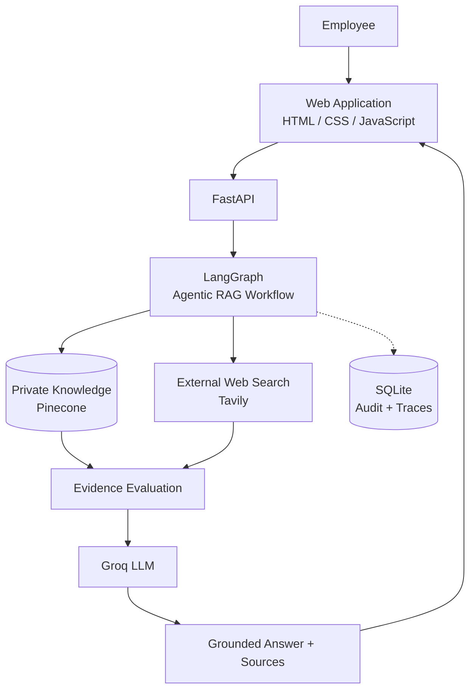
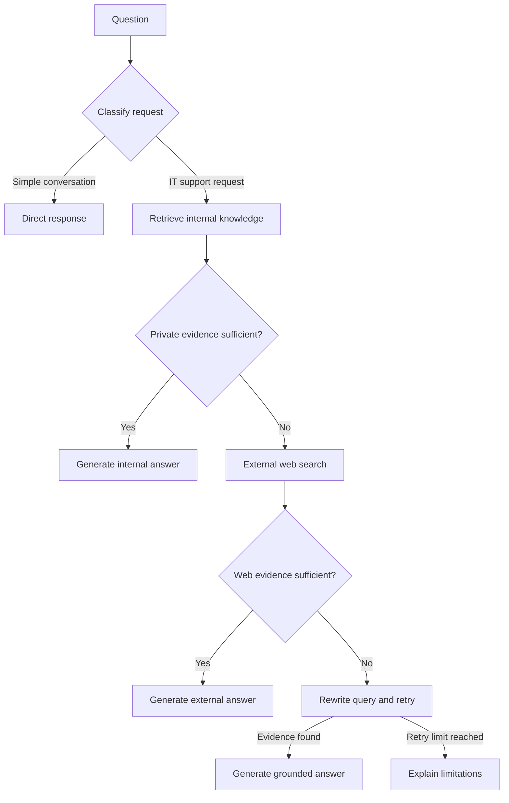

# Enterprise IT Knowledge Assistant

> An Agentic RAG assistant that gives employees fast, evidence-based answers from approved internal IT documentation, and falls back to controlled external web search only when internal knowledge is insufficient.

---

## Table of Contents

1. [Overview](#1-overview)
2. [Key Features](#2-key-features)
3. [Architecture](#3-architecture)
4. [Agentic RAG Workflow](#4-agentic-rag-workflow)
5. [Technology Stack](#5-technology-stack)
6. [Repository Structure](#6-repository-structure)
7. [Getting Started](#7-getting-started)
8. [Configuration](#8-configuration)
9. [API Reference](#9-api-reference)
10. [Document Ingestion](#10-document-ingestion)
11. [Audit Logging and Observability](#11-audit-logging-and-observability)
12. [Testing](#12-testing)
13. [Docker Deployment](#13-docker-deployment)
14. [Security and Production Readiness](#14-security-and-production-readiness)
15. [Known Limitations](#15-known-limitations)
16. [Measuring Business Value](#16-measuring-business-value)

---

## 1. Overview

### The problem

Company X (approx. 1,500 employees) maintains internal IT documentation covering remote access, account security, software installation, endpoint troubleshooting, network connectivity, and service-desk procedures. Employees still struggle to find the right answer:

- Keyword search returns irrelevant or outdated documents.
- General-purpose AI assistants can produce answers that are incomplete, outdated, or unsupported by approved documentation.
- Repetitive questions end up as tickets, adding load on IT operations.

### The solution

The Enterprise IT Knowledge Assistant is a conversational interface over internal IT knowledge. For each question it:

1. Retrieves relevant internal documentation.
2. Evaluates whether the evidence actually answers the question.
3. Searches the public web only if internal evidence is insufficient.
4. Generates an answer grounded in the selected evidence, with source attribution.
5. Admits when it cannot find sufficient evidence instead of fabricating an answer.

### Design principles

| Principle | Meaning |
|---|---|
| **Internal knowledge first** | Approved company documentation is always preferred over public information. |
| **Evidence-based responses** | Retrieved content is graded before it is used to generate an answer. |
| **Controlled source selection** | External search is invoked only when internal evidence is insufficient. |
| **Transparent execution** | The workflow path and sources are exposed for inspection. |
| **Maintainable knowledge** | Authorized administrators ingest new documents without code changes. |

---

## 2. Key Features

- **Semantic internal retrieval** — natural-language questions, no need to know document names or keywords.
- **Evidence grading** — retrieved chunks are evaluated for sufficiency before answering.
- **Conditional web search** — Tavily is used only as a fallback, and external content is labeled as non-authoritative.
- **Query rewriting with bounded retries** — vague questions are reformulated, subject to a configured retry limit.
- **Direct responses** — greetings and small talk skip the retrieval pipeline.
- **Document ingestion** — admin-protected endpoint for extraction, chunking, embedding, and indexing.
- **Workflow tracing** — every response includes the decision path taken.
- **Audit records** — lightweight SQLite storage of requests and workflow traces.
- **Containerized** — Dockerfile for reproducible packaging.

### Example questions

- *How do I connect to the company VPN from home?*
- *What is the approved procedure for resetting my password?*
- *Can IT support request my MFA code?*
- *How do I install approved software on my work laptop?*

---

## 3. Architecture

The system has four layers: a web interface, an API layer, an agent orchestration layer, and supporting knowledge and search services.



### Components

| Component | Responsibility |
|---|---|
| **Web application** | Employee-facing chat and document-upload interface |
| **FastAPI** | Chat, health-check, and ingestion endpoints |
| **LangGraph** | Routing, retrieval, evidence grading, query rewriting, conditional transitions |
| **Pinecone** | Stores and retrieves vector representations of internal documentation |
| **Embedding model** | Converts questions and document chunks into vectors |
| **Groq** | Classification, grading, rewriting, and response generation |
| **Tavily** | Public web search when internal evidence is insufficient |
| **SQLite** | Audit records and workflow traces |
| **Docker** | Reproducible packaging and deployment |

---

## 4. Agentic RAG Workflow

A conventional RAG pipeline retrieves documents and immediately generates an answer. This system evaluates the evidence and chooses the next action dynamically.



### Stages

| # | Stage | Description |
|---|---|---|
| 1 | **Question classification** | Distinguishes greetings from requests that need retrieval. |
| 2 | **Private retrieval** | Searches the Pinecone knowledge base for relevant chunks. |
| 3 | **Evidence evaluation** | Grades whether retrieved content adequately addresses the question. |
| 4 | **Conditional source selection** | Sufficient private evidence leads to an internal answer; otherwise Tavily is invoked. |
| 5 | **External evidence evaluation** | Grades whether web results are useful for the question. |
| 6 | **Query rewriting and retry** | Reformulates the query and retries, up to a configured limit. |
| 7 | **Response generation** | Produces an answer grounded in the selected evidence, or communicates the limitation. |
| 8 | **Execution tracing** | Records path, retrieval outcomes, grades, and source selection. |

All conditional transitions and retry limits are governed by the implemented LangGraph workflow in `app/rag/workflow.py`.

> **Note:** Evidence grading is probabilistic and does not guarantee factual correctness. Externally sourced information is never presented as authoritative internal guidance.

---

## 5. Technology Stack

| Technology | Purpose |
|---|---|
| Python | Application development and orchestration |
| LangGraph | Stateful agent workflow and conditional execution |
| FastAPI | REST API and backend services |
| Groq | Language-model inference |
| Pinecone | Vector storage and semantic retrieval |
| Hugging Face Sentence Transformers | Local embedding generation (if configured) |
| OpenAI | Optional embedding / LLM provider (if configured) |
| Tavily | External web search |
| SQLite | Lightweight audit logging |
| HTML, CSS, JavaScript | Web interface |
| Docker | Application packaging |
| pytest | Automated testing |

---

## 6. Repository Structure

```text
enterprise-it-knowledge-assistant/
│
├── app/
│   ├── api/
│   │   └── routes.py            # API endpoints
│   ├── core/
│   │   ├── config.py            # Environment variables and settings
│   │   └── logging.py           # Logging configuration
│   ├── rag/
│   │   ├── state.py             # Workflow state and decision structures
│   │   ├── vectorstore.py       # Embeddings and Pinecone retrieval
│   │   └── workflow.py          # Agentic RAG graph
│   ├── services/
│   │   ├── audit.py             # Audit records and workflow traces
│   │   └── ingestion.py         # Extract, chunk, prepare documents
│   └── main.py                  # FastAPI application entry
│
├── data/
│   └── sample_kb/
│       ├── company_it_handbook.md
│       └── service_desk_runbook.md
│
├── static/
│   ├── css/style.css
│   └── js/app.js
│
├── templates/
│   └── index.html
│
├── tests/
│   └── test_ingestion.py
│
├── uploads/
├── .env.example
├── .gitignore
├── Dockerfile
├── ingest_sample_kb.py          # Ingests the initial knowledge base
├── requirements.txt
├── run.py                       # Application launcher
└── README.md
```

---

## 7. Getting Started

### Prerequisites

- Python version compatible with the project dependencies
- Git
- A [Groq](https://console.groq.com) API key
- A [Pinecone](https://www.pinecone.io) account and API key
- A [Tavily](https://tavily.com) API key
- An OpenAI API key, **only if** the configured implementation uses OpenAI services
- Docker, if containerized deployment is required

Only the credentials required by your active configuration need to be provided.

### 1. Clone the repository

```bash
git clone <REPOSITORY_URL>
cd enterprise-it-knowledge-assistant
```

Replace `<REPOSITORY_URL>` with the repository address supplied by the project maintainer.

### 2. Create a virtual environment

```bash
python -m venv venv
```

Activate it:

```bash
# macOS / Linux
source venv/bin/activate
```

```powershell
# Windows
venv\Scripts\activate
```

### 3. Install dependencies

```bash
python -m pip install --upgrade pip
pip install -r requirements.txt
```

### 4. Configure environment variables

```bash
cp .env.example .env
```

Edit `.env` with your credentials. See [Configuration](#8-configuration).

### 5. Configure Pinecone

Create the Pinecone index if the application does not create it automatically. The vector **dimension must match the active embedding model**, and the index name, namespace, and similarity metric must match the retrieval implementation.

### 6. Ingest the sample knowledge base

```bash
python ingest_sample_kb.py
```

Confirm ingestion completes successfully before testing questions that depend on internal documents.

### 7. Run the application

```bash
python run.py
```

| Resource | URL |
|---|---|
| Web interface | http://127.0.0.1:8000 |
| API documentation (Swagger) | http://127.0.0.1:8000/docs |
| Health check | http://127.0.0.1:8000/api/health |

These addresses assume the application listens on port `8000`.

---

## 8. Configuration

Create a `.env` file in the project root:

```dotenv
# Language model
GROQ_API_KEY=your_groq_api_key
GROQ_MODEL=openai/gpt-oss-20b

# OpenAI - only if required by the implementation
OPENAI_API_KEY=your_openai_api_key
OPENAI_MODEL=gpt-4o-mini
EMBEDDING_MODEL=text-embedding-3-small

# External search
TAVILY_API_KEY=your_tavily_api_key

# Vector database
PINECONE_API_KEY=your_pinecone_api_key
PINECONE_INDEX_NAME=enterprise-it-knowledge
PINECONE_NAMESPACE=company-it-kb

# Administrative access
ADMIN_API_KEY=replace-with-a-strong-random-secret

# Application
APP_ENV=development
```

### Variable reference

| Variable | Required | Description |
|---|---|---|
| `GROQ_API_KEY` | Yes | Groq API credential |
| `GROQ_MODEL` | Yes | Groq model used for classification, grading, rewriting, generation |
| `TAVILY_API_KEY` | Yes | Credential for external web search |
| `PINECONE_API_KEY` | Yes | Pinecone credential |
| `PINECONE_INDEX_NAME` | Yes | Pinecone index name |
| `PINECONE_NAMESPACE` | Yes | Namespace for knowledge-base vectors |
| `ADMIN_API_KEY` | Yes | Secret protecting ingestion and admin operations |
| `EMBEDDING_MODEL` | Yes | Embedding model used for ingestion **and** retrieval |
| `OPENAI_API_KEY` | Conditional | Only if OpenAI services are configured |
| `OPENAI_MODEL` | Conditional | Only if OpenAI services are configured |
| `APP_ENV` | No | `development` or `production` |

Model identifiers and the embedding configuration must match the integrations supported by the codebase.

### Embedding consistency

Use **one embedding model** for both ingestion and query retrieval.

| Model | Dimensions |
|---|---|
| `all-MiniLM-L6-v2` (Sentence Transformers) | 384 |
| `text-embedding-3-small` (OpenAI) | 1536 by default |

If you change the embedding model, the Pinecone index dimension must match the new output dimension and existing vectors must be **re-indexed**.

### Security requirements for configuration

- Keep `.env` out of version control.
- Use strong, randomly generated administrative secrets.
- Never expose API keys through frontend JavaScript.
- Limit credentials to the minimum permissions required.
- Never commit confidential company documents or sensitive uploads.
- Use a managed secret store for production deployments.

---

## 9. API Reference

Interactive documentation is available at `/docs` when the application is running. The examples below are illustrative; the authoritative request and response schemas are defined by the implementation.

### `GET /api/health`

Checks application availability.

```bash
curl http://127.0.0.1:8000/api/health
```

### `POST /api/chat`

Submits a question to the Agentic RAG workflow.

**Request**

```json
{
  "question": "How do I reset my company password?"
}
```

**Illustrative response**

```json
{
  "answer": "Follow the approved password-reset procedure in the internal IT documentation.",
  "source_used": "private_kb",
  "trace": [
    "Router → KB",
    "Private KB retrieval completed",
    "Evidence grade → GOOD",
    "Answer generated from internal knowledge"
  ],
  "citations": []
}
```

| Field | Description |
|---|---|
| `answer` | Generated response |
| `source_used` | Which source supported the answer (e.g. private knowledge base or external search) |
| `trace` | Ordered description of workflow decisions |
| `citations` | Supporting sources |

In production, citations should identify the supporting document and, where possible, link to a location the requesting employee is authorized to access.

### `POST /api/ingest`

Accepts a document for ingestion into the private knowledge base. Requires the `X-Admin-Key` header.

```bash
curl -X POST "http://127.0.0.1:8000/api/ingest" \
  -H "X-Admin-Key: YOUR_ADMIN_API_KEY" \
  -F "file=@internal_policy.pdf"
```

The multipart field name and accepted file formats must match the actual API implementation.

---

## 10. Document Ingestion

Supported formats depend on the configured loaders and may include **PDF, TXT, Markdown, and DOCX**.

```text
Upload → Authenticate & validate → Extract text → Chunk → Embed → Store in Pinecone → Available for retrieval
```

| Step | Description |
|---|---|
| 1 | Receive the uploaded document |
| 2 | Authenticate the administrator and validate the file |
| 3 | Extract document text |
| 4 | Split text into manageable chunks |
| 5 | Generate vector embeddings |
| 6 | Store vectors and metadata in Pinecone |
| 7 | Make successfully indexed content available for retrieval |

Metadata should preserve useful attributes such as document title, source location, version, and access permissions where supported.

For production use, ingestion should also handle **document updates, deletion, duplicate uploads, failed indexing, and re-indexing** after embedding-model changes.

---

## 11. Audit Logging and Observability

SQLite stores audit records and workflow execution traces. A typical trace includes:

```text
Request received
Question classified
Private knowledge retrieval completed
Private evidence graded
External search invoked (if required)
Query rewritten (if required)
Answer generated
Response returned
```

### Recommended operational metrics

- Request volume and latency
- Retrieval success rate
- Evidence-grading outcomes
- External search frequency
- Retry frequency
- Insufficient-evidence rate
- API errors and dependency failures
- Estimated model and search costs

Audit records must follow the organization's data-retention and privacy requirements. Do not log sensitive document contents, credentials, or unnecessary personal information.

---

## 12. Testing

Run the automated tests:

```bash
pytest -v
```

The suite should be extended to cover the principal workflow paths and operational requirements:

- Document extraction and chunking
- Supported and unsupported uploads
- Embedding and retrieval consistency
- Internal-knowledge-first routing
- Evidence grading and conditional web search
- Query rewriting and retry limits
- Insufficient-evidence responses
- Source attribution and citation correctness
- API validation and error handling
- Unauthorized ingestion attempts
- External-service failures and timeouts

Distinguish **deterministic application behavior** from **model-dependent outcomes**, and use controlled fixtures for routing, grading, and retrieval tests where possible.

---

## 13. Docker Deployment

Build the image:

```bash
docker build -t enterprise-it-knowledge-assistant .
```

Run the container:

```bash
docker run --rm \
  --env-file .env \
  -p 8000:8000 \
  enterprise-it-knowledge-assistant
```

These commands assume the Dockerfile installs dependencies and starts the application on port `8000`.

Before production deployment, validate container configuration, secret management, network access, persistent storage, dependency health checks, and deployment-specific settings.

---

## 14. Security and Production Readiness

The application may process internal policies and operational procedures. The current architecture is a foundation; an API key, audit logging, or container packaging alone does **not** establish production readiness.

### Identity and access management

- Integrate with the organization's identity provider (SSO).
- Apply role-based access control.
- Enforce document-level authorization during retrieval.
- Restrict ingestion and admin operations to authorized personnel.

### Data protection

- Protect all API traffic with HTTPS.
- Manage credentials through secure secret storage.
- Define data retention and deletion procedures.
- Prevent unauthorized access to uploaded documents and audit records.
- Ensure confidential information is not sent to public search providers or external model services without authorization.

### AI and retrieval security

- Treat retrieved documents and web content as **untrusted input**.
- Defend against prompt injection and malicious document instructions.
- Evaluate source relevance and answer faithfulness.
- Clearly distinguish internal policy from external information.
- Return an insufficient-evidence response when reliable support cannot be established.

### Reliability and monitoring

- Apply request timeouts and bounded retries.
- Monitor service health and error rates.
- Track retrieval and answer-quality metrics.
- Validate behavior during external-service outages.
- Establish procedures for updating, removing, and re-indexing documents.

---

## 15. Known Limitations

- Evidence grading is model-based and probabilistic; it can misjudge sufficiency.
- The default ingestion endpoint is protected by a shared admin key, not per-user identity.
- Document-level access control is not enforced during retrieval unless implemented.
- Web search results come from public sources and are not vetted company policy.
- SQLite is suitable for lightweight audit logging, not high-volume or multi-instance production workloads.
- Changing the embedding model requires re-indexing the knowledge base.

---

## 16. Measuring Business Value

The solution is intended to improve knowledge accessibility, reduce repetitive support requests, and help employees resolve common IT issues faster. These are **evaluation targets, not assumed outcomes**; establish a baseline before deployment and review results during a controlled pilot.

| Metric | What it tells you |
|---|---|
| Repetitive ticket reduction | Deflection of common requests |
| Self-service resolution rate | Share of questions resolved without IT |
| Answer accuracy and faithfulness | Quality of grounded responses |
| Retrieval relevance and citation correctness | Retrieval and attribution quality |
| Average response time | User experience and performance |
| Employee satisfaction | Adoption and trust |
| Cost per resolved query | Operating efficiency |